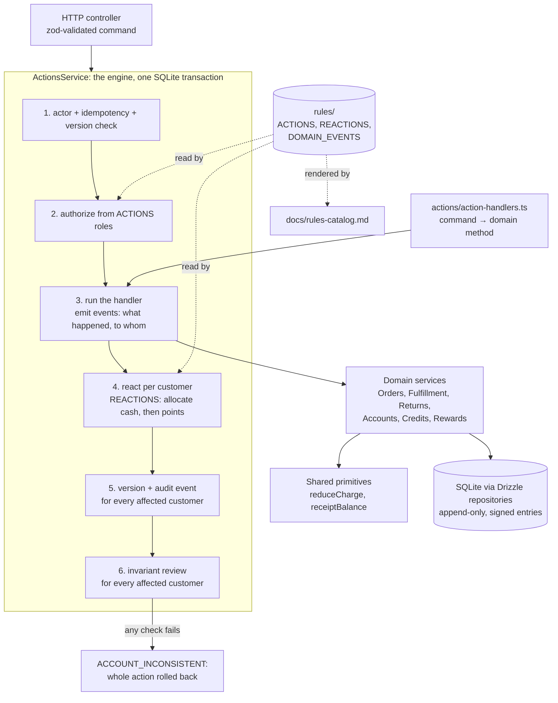
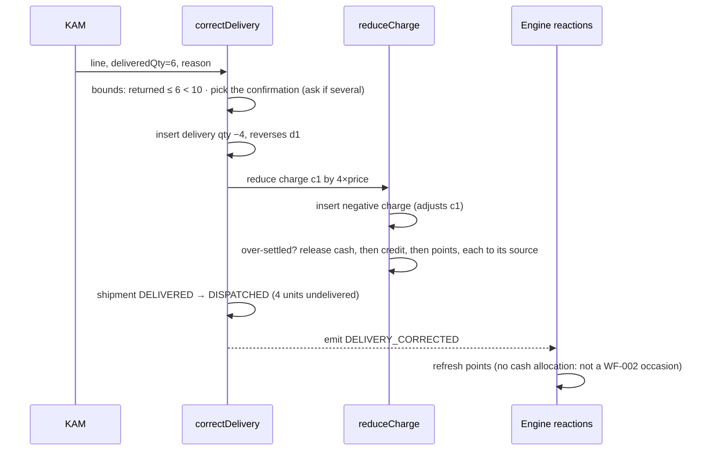

# Final architecture (as built)

**Written by:** Claude (Sonnet 5.5), prompted by Chetan, 31 Oct 2026. Agent-written; the evolution that led here is in [draft 1](01-first-draft.md), [draft 2](02-refined-draft.md) and [draft 3](03-post-research-draft.md).
**Scope:** the two features (FDSK-169, FDSK-170) and the middle-ground rule layer under them. The other [solution](../solutions-comparison.md) (plain services) is kept at git tag `solution-a-plain-services`.

## 1. The problem, restated for this codebase

The brief's combinatorial explosion shows up here in two places, and they need different tools.

| Where it shows up                                                                          | What fixes it                                                                                           |
| ------------------------------------------------------------------------------------------ | ------------------------------------------------------------------------------------------------------- |
| **Money and quantities.** A change to one ledger must leave every other ledger consistent. | Shared primitives (`reduceCharge`, `receiptBalance`) plus the pre-commit invariant review as oracle.    |
| **Wiring.** Who may do what, what must run afterwards, which customers an action touches.  | Rules as data (action catalog + reaction table), one engine that enforces them, a generated rule sheet. |

Putting a general rules engine over both would hide the first behind the second. This design keeps them apart on purpose.

## 2. Sub-problems and where each one lives

| #   | Sub-problem                                                          | Rules                     | Lives in                                                                              |
| --- | -------------------------------------------------------------------- | ------------------------- | ------------------------------------------------------------------------------------- |
| S1  | Shrink a charge and give back cash → credit → points                 | WF-003, ACC-001           | `AccountsService.reduceCharge` (extracted from Returns; used by returns and FDSK-170) |
| S2  | Signed delivery, one signed charge per confirmation                  | WF-005, WF-006, FUL-001   | `FulfillmentService.correctDelivery`, `deliveries.reverses_delivery_id`               |
| S3  | Reopen a delivered shipment that still has undelivered units         | FUL-006                   | `correctDelivery`                                                                     |
| S4  | Pick the confirmation to reduce, or ask                              | brief 7.2                 | `correctDelivery` + existing `Decision` mechanism                                     |
| S5  | Release a receipt's allocations, record the move, create the receipt | ACC-002, ACC-004, CUS-001 | `AccountsService.moveReceipt`, `receipt_moves`                                        |
| S6  | One definition of free cash                                          | ACC-002                   | `ReceiptBalance` / `AccountsService.receiptBalance`                                   |
| S7  | Cash allocation and points after the right events, per customer      | WF-002, REW-001..003      | `rules/action-catalog.ts` (`REACTIONS`) + `ActionsService.react`                      |
| S8  | Versions, audit events and review for every affected customer        | WF-001                    | `ActionsService`, `ActionContext.customerIds`                                         |
| S9  | Who may run what; keep docs and code from drifting                   | business-terms table      | `ACTIONS[*].roles`, generated `docs/rules-catalog.md`, `rules-catalog.test.ts`        |

## 3. Shape of the system



### Engine contract

1. Verify the actor, replay a stored result for a repeated idempotency key, resolve the primary aggregate, check its version.
2. `authorize(c, ...ACTIONS[type].roles, 'ADMIN')`. The only role check in the codebase.
3. Run the handler. Handlers write through repositories and call `emit(c, EVENT, customerId?)`. `emit` rejects an event not listed in `ACTIONS[type].emits` and marks the named customer as affected.
4. For each customer named by an event, in the order first named: run `allocateCash` if any of their events is in `REACTIONS.allocateCash.after`, then `refreshRewards` if any is in `REACTIONS.refreshRewards.after`. The only call sites of either.
5. For each affected customer: bump the customer and all their order versions, append one audit event.
6. Run `AuditService.review` for each affected customer. Any failed check aborts the action and rolls everything back. This is the oracle: the framework makes rules visible, the review proves the books.

### What the catalog holds

```ts
CORRECT_DELIVERY: action(
  ['KAM'],
  'Lower an overstated delivery confirmation to what really arrived.',
  ['FUL-001', 'FUL-006', 'WF-001', 'WF-003', 'WF-006'],
  ['DELIVERY_CORRECTED'],
),
MOVE_CUSTOMER_PAYMENT: action(
  ['ACCOUNTS'],
  'Move a payment recorded against the wrong customer to the right one.',
  ['CUS-001', 'ACC-002', 'ACC-004', 'WF-001'],
  ['PAYMENT_RELEASED', 'PAYMENT_RECEIVED'],
),
```

```ts
REACTIONS.allocateCash.after    = PAYMENT_RECEIVED, CASH_ALLOCATION_REQUESTED, DELIVERY_CONFIRMED,
                                  GOODS_CORRECTED, RETURN_SETTLED          // exactly the WF-002 occasions
REACTIONS.refreshRewards.after  = the five above + DEMAND_CANCELED, DELIVERY_CORRECTED, PAYMENT_RELEASED
```

Adding a command means three edits: the zod schema in `shared`, an `ACTIONS` entry, a handler in `action-handlers.ts`. The compiler flags a missing entry or handler. Then `pnpm rules:doc`. See `.claude/commands/add-action.md`.

## 4. Data model

One migration, `0006`. No existing row changes.

```sql
-- deliveries: a negative qty must name the confirmation it reduces
ALTER ... deliveries ADD reverses_delivery_id TEXT NULL;
CHECK (qty > 0 OR (qty < 0 AND reverses_delivery_id IS NOT NULL))   -- was: qty > 0

CREATE TABLE receipt_moves (
  id TEXT PRIMARY KEY,
  receipt_id TEXT NOT NULL,        -- the receipt on the wrong customer (kept)
  to_receipt_id TEXT NOT NULL,     -- the new receipt on the right customer
  from_customer_id TEXT NOT NULL,
  to_customer_id TEXT NOT NULL,
  amount_paise INTEGER NOT NULL CHECK (amount_paise > 0),
  reason TEXT NOT NULL,
  action_id TEXT NOT NULL,
  created_at TEXT NOT NULL
);
```

`receivable_entries.kind` gains the value `DELIVERY_CORRECTION` (a text column, no DDL). SQLite cannot change a CHECK in place, so the migration rebuilds `deliveries` (rows copied). `drizzle-kit` named the new column in the copy's `SELECT`, which the old table lacks; that line was fixed by hand and is covered by a migration test.

## 5. API

No new routes. Both commands use `POST /api/crm/actions` and the existing envelope, idempotency and version rules.

| Command                 | Payload                                                                                       | Role            | Version used                | Outcomes beyond the usual                                                                                                                                                 |
| ----------------------- | --------------------------------------------------------------------------------------------- | --------------- | --------------------------- | ------------------------------------------------------------------------------------------------------------------------------------------------------------------------- |
| `CORRECT_DELIVERY`      | `{ orderId, shipmentId, reason, items: [{ shipmentLineId, deliveredQty, confirmationId? }] }` | KAM, Admin      | the order                   | `NEEDS_DECISION` (one question per ambiguous line); `NOTHING_TO_CORRECT`, `BELOW_RETURNED`, `QUANTITY_EXCEEDED`, `CONFIRMATION_NOT_FOUND`, `SHIPMENT_STATE`               |
| `MOVE_CUSTOMER_PAYMENT` | `{ customerId, receiptId, toCustomerId, reason }`                                             | Accounts, Admin | the customer moved **from** | `aggregateVersions` has both customers; `references.receiptId` is the new receipt; `RECEIPT_CREDIT_FUNDED`, `RECEIPT_ALREADY_MOVED`, `SAME_CUSTOMER`, `RECEIPT_NOT_FOUND` |

`GET /crm/customers/:id/ledger` now includes `receiptMoves`.

## 6. How the two features work

### FDSK-170, overstated delivery: 10 dispatched, 10 marked delivered, 6 arrived



Worked numbers (sku-a, ₹100 a unit, 1000 points per unit, charge ₹1,000 fully paid): the charge falls to ₹600, ₹400 returns to the receipt as free cash, points earned fall from 10,000 to 6,000 (4,000 stay locked). When Warehouse confirms the last 4, `DELIVERY_CONFIRMED` allocates the free ₹400 to the new charge and points return to 10,000.

### FDSK-169, payment recorded against the wrong customer

```mermaid
sequenceDiagram
    participant ACC as Accounts
    participant M as moveReceipt
    participant R as Engine reactions
    ACC->>M: customer A, receipt X, to customer B, reason
    M->>M: guards: belongs to A · B ≠ A · not moved · not credit-funded
    M->>M: negative allocation for every charge X settles on A
    M->>M: new receipt X' on B (same amount and bank reference)
    M->>M: receipt_moves(X → X'): consumes X's value, t = m
    M-->>R: emit PAYMENT_RELEASED(A), PAYMENT_RECEIVED(B)
    R->>R: A: refresh points
    R->>R: B: allocate cash by priority, then refresh points
    R->>R: review A and B; bump both versions; audit event on both
```

## 7. Invariants and why they hold

| Invariant                                                 | Why                                                                                                                             |
| --------------------------------------------------------- | ------------------------------------------------------------------------------------------------------------------------------- |
| History is never edited (WF-001)                          | Only inserts. Corrections are negative rows linked by `reverses_delivery_id` / `adjusts_id`, and moves are a separate document. |
| `0 ≤ r ≤ d ≤ s` (FUL-001)                                 | Checked before writing (`BELOW_RETURNED`, `NOTHING_TO_CORRECT`), and again by the review's `shipment-quantities` check.         |
| `b_j ≥ 0` (ACC-001)                                       | `reduceCharge` releases exactly the over-settlement; review check `settlement:*`.                                               |
| `u_i = m_i − a_i − f_i − t_i ≥ 0` (ACC-002)               | `ReceiptBalance` is the single definition; review check `cash:*` uses it.                                                       |
| One charge per confirmation, value = qty × price (WF-005) | Review check `delivery-charge:*` now covers negative confirmations (`DELIVERY_CORRECTION` kind).                                |
| Customer accounts never mix (CUS-001)                     | Cash is released from A's charges and re-recorded as B's own receipt; no allocation ever points across customers.               |
| Points conserve entitlement (REW)                         | Not re-implemented. `refresh` re-derives them from cash and retained units; the review's `reward-conservation` verifies it.     |
| An action that touches two customers is checked on both   | The engine reviews every customer in `ActionContext.customerIds` before commit.                                                 |

## 8. Patterns used

| Pattern                               | Where                                                     | Why it fits here                                                                               |
| ------------------------------------- | --------------------------------------------------------- | ---------------------------------------------------------------------------------------------- |
| Command registry                      | `action-handlers.ts`                                      | Replaces a 22-arm `switch`; exhaustive by type.                                                |
| Rules as data (decision table)        | `ACTIONS`, `REACTIONS`, generated rule sheet              | Roles and occasions are policy, readable by a non-engineer, testable against the docs.         |
| Domain events + reactions, in-process | `emit`, `ActionsService.react`                            | Handlers say what happened; follow-up work is declared once. No broker, no saga runner needed. |
| Compensating (signed) entries         | `deliveries`, `receivable_entries`, `payment_allocations` | Already the house style; keeps history and audit.                                              |
| Specification / invariant oracle      | `AuditService.review`                                     | Checks results rather than prescribing steps, so new features cannot silently break old rules. |
| Question instead of guess             | `DomainDecision` in `correctDelivery`                     | Brief rule 7.2: ambiguity becomes a question, not a hidden default.                            |

## 9. Limitations, stated plainly

- A receipt that ever funded a credit note cannot be moved. CRD-006 keeps funding reserved forever and no action un-funds it. Splitting a receipt would be a new operation with no basis in the rules.
- A move is whole. There is no partial move.
- The moved receipt is dated at the time of the move for cash priority (ACC-003), not the original payment date.
- A delivery correction only lowers. Raising is a normal confirmation.
- Without `confirmationId`, the system asks whenever a line has more than one confirmation with units left. It never guesses by recency.
- Cash released by a correction stays free until the next WF-002 occasion or an explicit `ALLOCATE_PAYMENT`. This follows WF-002 literally and is stated in the rules, but a stakeholder may prefer immediate re-allocation. The change is one line in `REACTIONS`.
- Preconditions (quantity bounds, charge limits) are ordinary code, not catalog data. Putting them in the catalog would hide the arithmetic they protect.
- `termsVersion` in code is still `2026-10-26.1`; the docs say that ACC-004 and WF-006 were added after it. Existing tests pin the string.
- The UI is deliberately small: one dialog per action, in the style of the existing dialog. It is a single component with per-type branches, the same shape of problem as the old `switch`. I did not refactor it.
- The framework does not make rules safe by itself. It makes them visible and enforces who, what-follows and which-customers. Correctness of money logic still rests on the models and the review.

## 10. Predictions from draft 3, checked

| Prediction                                          | Result                                                                                                                                               |
| --------------------------------------------------- | ---------------------------------------------------------------------------------------------------------------------------------------------------- |
| A new action needs 3 edits, with compiler help      | Yes: schema, catalog entry, handler. Plain solution needed 7 places.                                                                                 |
| No service calls `authorize` or the reaction pair   | Yes: one `authorize` call site and one reaction call site, both in `ActionsService`.                                                                 |
| Behaviour unchanged: existing tests green, unedited | Yes: all 251 original tests pass untouched; 269 before adding the catalog tests, 276 after.                                                          |
| Framework costs about 250 lines                     | Measured +271 nonblank source lines over the plain solution (`server/src` + `shared/src`: 7,774 → 8,045; baseline 7,338). Decision nodes 469 → 457.  |
| (unplanned) The framework would not shrink the code | Confirmed: it moves wiring into one place and adds guards, it does not reduce lines. That is the honest result, and the decision guide builds on it. |

## 11. What changed from the earlier drafts

- Draft 2 treated the delivery correction as one confirmation. Implementation showed returns consume the _oldest_ charges first, so a confirmation can carry fewer units than it stood for. The correctable units are now `min(standing, units its charge still carries)`.
- Draft 2 had no `ReceiptBalance`. Free cash was computed four times; adding the moved-value term to four copies was the trigger to extract one definition.
- Draft 3 proposed events at a high level. The detail that made them worthwhile arrived with FDSK-169: a per-action reaction list cannot say "allocate on B but not on A". Events name the customer, so the table needs no special case.
