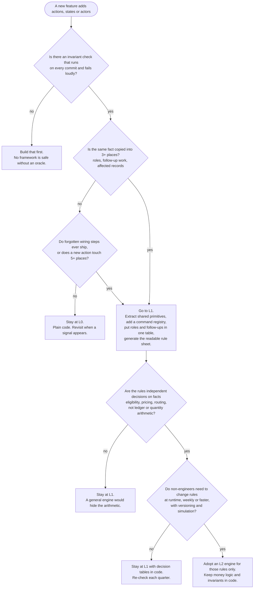

# When to invest in a rules framework

**Question.** Code is cheap to write. A rules framework is not cheap to own. When does it pay, and when is a middle ground enough?

**Short answer.** Add structure in this order, and stop at the first level that fixes the pain you can actually measure.

| Level  | What it is                                                                                                                                             | Typical cost        | Example in this repo                                                              |
| ------ | ------------------------------------------------------------------------------------------------------------------------------------------------------ | ------------------- | --------------------------------------------------------------------------------- |
| **L0** | Plain services. A branch per case.                                                                                                                     | none                | `solution-a-plain-services`                                                       |
| **L1** | Middle ground: shared primitives, an exhaustive command registry, rules-as-data for roles and follow-ups, a generated rule sheet, an invariant oracle. | a few hundred lines | `main` (about 270 net lines)                                                      |
| **L2** | General engine: a rule DSL or RETE engine, statecharts per entity, runtime-editable rules.                                                             | thousands of lines  | not built; the brief puts a 10,000-line engine against 10–15 branches as overkill |

## 1. Decision tree

## 2. Signals to measure

Each signal is cheap to count from git and the issue tracker. Score each 0, 1 or 2 against the thresholds shown. The thresholds are judgement, not law; change them for your team and write down why.

| #   | Signal                                                                      | 0                  | 1                   | 2                         | This repo (before the work)                     | Score |
| --- | --------------------------------------------------------------------------- | ------------------ | ------------------- | ------------------------- | ----------------------------------------------- | :---: |
| S1  | Number of commands (actions)                                                | ≤ 10               | 11–25               | > 25                      | 20                                              |   1   |
| S2  | Times one fact is copied (role sets, follow-up calls, doc tables)           | ≤ 2                | 3–6                 | > 6                       | 20 `authorize`, 6 reaction tails, 1 docs table  |   2   |
| S3  | Places to edit for one new action (median of the last three)                | ≤ 3                | 4–6                 | ≥ 7                       | 7                                               |   2   |
| S4  | Wiring omissions that reached review or production in the last two quarters | 0                  | 1                   | ≥ 2                       | 0 known; the compiler could not have caught one |   1   |
| S5  | Actions touching more than one aggregate (customer, order, …)               | none               | 1–2                 | several                   | 0 before FDSK-169                               |   0   |
| S6  | Non-engineers must read or sign off the rules                               | no                 | sometimes           | routinely                 | the brief asks for it                           |   1   |
| S7  | How often rules change, and who changes them                                | rarely, developers | monthly, developers | weekly, or non-developers | by code review                                  |   0   |
| S8  | Several authors, including coding agents, add actions in parallel           | one                | two or three        | many                      | agents are expected                             |   1   |

**Reading the total (this repo: 8 of 16).**

- 0–4: stay at **L0**.
- 5–11: go to **L1**, and add pieces in the order of section 4.
- 12–16: **L1 is the floor**. Consider L2 only for rules that pass both gates below.

**Gates for L2.** Both must hold, whatever the score.

- **G1. Shape.** The rules are independent decisions over facts (eligibility, pricing, routing). If they are workflows with exact arithmetic and a required order, such as this ledger, a general engine hides the order and the money.
- **G2. Ownership.** People who do not write code must change them at runtime, often, with versioning and simulation. If a pull request is acceptable, a table in code is cheaper and safer.

## 3. Is it worth the cost? A break-even sketch

Let `F` be the framework's net lines, `k` the extra wiring lines an action costs without it, and `n` the number of actions you expect to add.

- **Lines:** the framework repays itself in size when `n × k > F`. Here `F ≈ 270` and `k ≈ 10`, so about 27 further actions. At the current pace that is not soon, and at 22 actions L1 is _larger_ than L0 (measured: [comparison](solutions-comparison.md)).
- **Risk:** the stronger argument. Let `p` be the chance that a new action ships with a forgotten step and `c` its cost. L1 turns many of those into compile errors, a failed test, or an exception. The framework pays when `n × p × c` is more than its upkeep. Estimate `p` from your own history (signal S4), not from this document.
- **Review time:** a generated rule sheet lets a non-engineer check who may do what in minutes. Count the hours saved per release.

Do not adopt L1 on lines alone. Adopt it because wiring facts are copied, omissions are plausible, an action can touch two aggregates, or someone other than the author has to read the rules.

## 4. What to add first inside L1

Order by cost against benefit. Each step stands alone; you can stop after any of them.

| Step | Add                                                               | Why first                                                                           | Done in this repo                                                  |
| ---- | ----------------------------------------------------------------- | ----------------------------------------------------------------------------------- | ------------------------------------------------------------------ |
| 1    | An invariant oracle that runs before every commit                 | Everything else relies on it. It turns "did we break a rule?" into a failing check. | existing `AuditService.review`, now run on every affected customer |
| 2    | Extract duplicated domain logic into one primitive                | Cheapest. It removes copies without adding a concept.                               | `reduceCharge`, `receiptBalance`                                   |
| 3    | An exhaustive command registry                                    | Makes omission a compile error.                                                     | `action-handlers.ts`                                               |
| 4    | Roles and follow-up occasions as data, with one enforcement point | Gives the rules one home and one reviewer.                                          | `rules/action-catalog.ts`                                          |
| 5    | A generated rule sheet plus a drift test                          | Makes the rules readable and keeps docs honest.                                     | `docs/rules-catalog.md`, `rules-catalog.test.ts`                   |
| 6    | Ambiguity becomes a question to the user, not a default           | Fits "mutations, or questions whose answers decide the mutations".                  | `NEEDS_DECISION` for the confirmation choice                       |

## 5. Signals that say you outgrew L1

- The catalog starts to hold conditions as strings or an expression language. Stop: that is a DSL by accident. Keep preconditions as code next to the data they protect.
- Rules need to change without a deploy, by someone who cannot open a pull request.
- Several teams own different rules and need separate release cycles or access control over them.
- You need to simulate a rule change against history before shipping it.
- The same decision (a price, an eligibility) is computed in more than one place with different inputs.

If two or more hold and the rules pass gates G1 and G2, move _those_ rules to an engine. Leave settlement, quantities and the oracle in code.

## 6. Signals that you adopted too much

- Adding an action takes more edits than before.
- You read the framework more than the domain code to understand a change.
- Behaviour depends on firing order you cannot see in one file.
- The framework has more tests than the domain it serves.

Back off one level and keep only the pieces that still remove a copy or a risk.

## 7. Worked evaluation of this repository

- Score 8 of 16. Gate G0 is met (the review exists). G1 fails: every rule here is ledger or quantity arithmetic with a required order. G2 fails: rules change by code review.
- **Decision: L1, stop there.** It was justified by copied wiring (S2, S3), the first action that touches two customers (S5), and the stated need for a readable rule sheet (S6), not by line count.
- **Next review trigger:** more than about 35 actions, a second multi-aggregate action, an omission that the compiler could have caught, or a stakeholder asking for runtime-editable policy.
